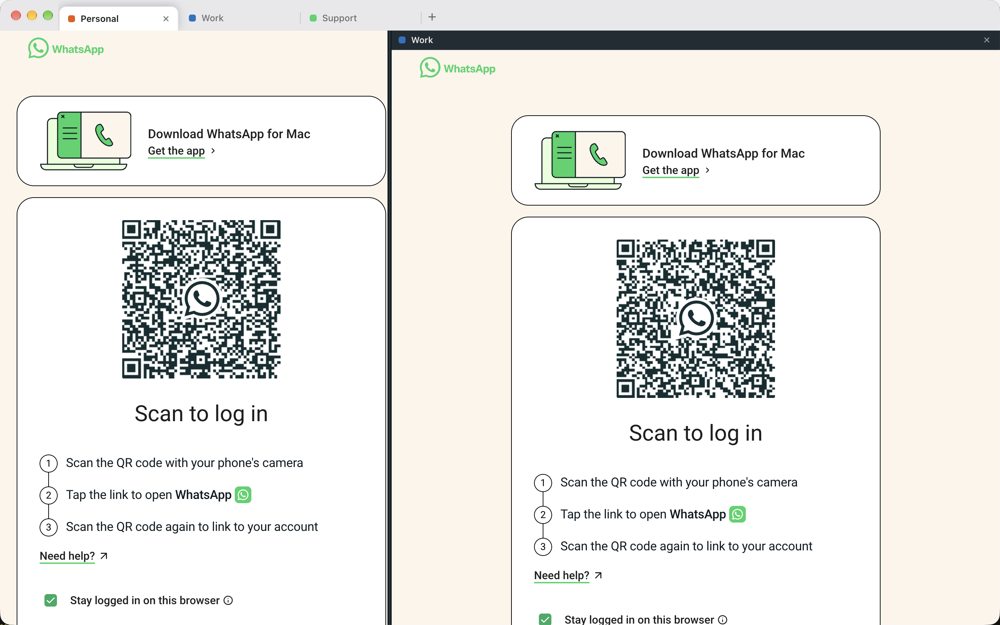

# MultiWA

Several WhatsApp Web accounts on one computer, one per tab. macOS and Windows.



- **One tab per account.** Each tab is its own WhatsApp Web session (separate cookies and storage), so every account stays logged in independently. Scan the QR code once per tab.
- **Sidekick-style tabs.** Drag to reorder, double-click to rename, badges with unread counts, Dock/taskbar badge with the total.
- **Two accounts side by side.** Right-click a tab → *Show in Right Pane* (or `⌘\`), drag the divider.
- **Several windows.** Right-click a tab → *Move to New Window*.
- **Notifications, calls, voice notes, downloads** work as in the browser; downloads land in your Downloads folder.
- No telemetry, no server, no WhatsApp automation: MultiWA never reads your messages. It only reads the tab title for the unread count.

## Install

Download from [Releases](https://github.com/AvvaMobile/AvvaMobile.MultiWA/releases): `MultiWA-<version>-arm64.dmg` / `-x64.dmg` (macOS, signed and notarized), `MultiWA-Setup-<version>.exe` (Windows, unsigned: SmartScreen → More info → Run anyway).

## Privacy and security

See [docs/SECURITY.md](docs/SECURITY.md). Short version: WhatsApp runs in a sandboxed view with no bridge to your computer; MultiWA grants it only microphone/camera, notifications, clipboard and fullscreen.

## Removing an account

Close its tab (✕) and confirm. Its WhatsApp session is deleted from this computer; nothing on your phone changes.

## Development

```sh
npm install
npm run dev          # electron-vite dev server
npm test             # vitest
npm run typecheck
npm run dist:mac     # local package
```

Architecture: [docs/ARCHITECTURE.md](docs/ARCHITECTURE.md). Releasing: [docs/RELEASING.md](docs/RELEASING.md).

MultiWA is an independent app and is not affiliated with WhatsApp or Meta.
